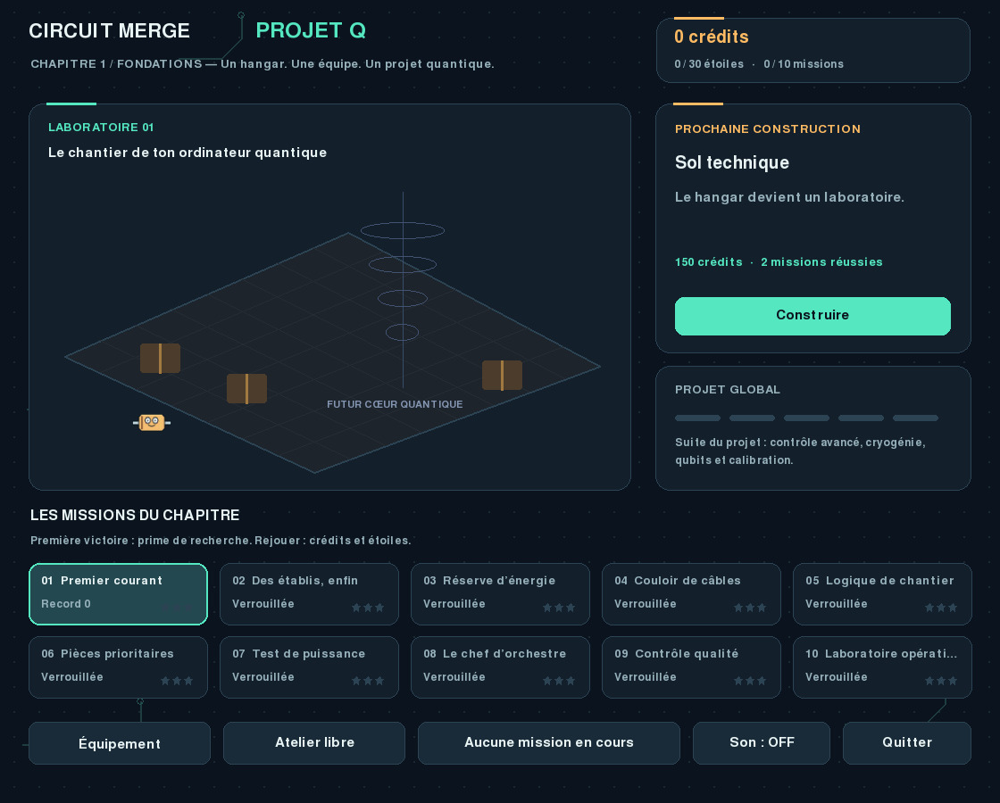

# Circuit Merge V3 — Projet Q

Construis le laboratoire qui accueillera ton ordinateur quantique !
Cette version livre **le chapitre 1 : Fondations**, avec dix missions,
cinq constructions visibles et trois bonus facultatifs. Les chapitres
suivants et la finalisation de l'ordinateur ne sont pas encore jouables.



## Installation Windows

1. Extraire entièrement le ZIP dans un nouveau dossier `Circuit_Merge_V3`.
2. Avec Python 3.10 à 3.14 installé, lancer `Installer_Windows.bat`.
3. Lancer `Lancer_Windows.bat`.

Internet est nécessaire pour l'installation ; ensuite le jeu fonctionne
hors ligne. Les dépendances restent `pygame-ce==2.5.8` et `pymunk==7.3.0`.
Garder la V2 dans son dossier permet de conserver les deux versions.

Installation manuelle depuis le dossier extrait :

```powershell
py -3 -m venv .venv
.\.venv\Scripts\python.exe -m pip install -r requirements.txt
.\.venv\Scripts\python.exe main.py
```

Sous Linux/macOS : `python3 -m venv .venv`, puis
`.venv/bin/python -m pip install -r requirements.txt` et
`.venv/bin/python main.py`.

## Jouer

Choisis une mission sur le chantier et lis son objectif. La livraison reste
identique à chaque essai : trouve les bons placements et orientations.
Les niveaux varient le stock initial, la largeur ou la hauteur du bac,
les pièces marquées et les objectifs de fabrication, de score ou de fusions.

| Action | Commande |
|---|---|
| Viser | Souris ou flèches gauche/droite |
| Lâcher | Relâcher le clic gauche dans le bac, ou Espace |
| Tourner | E, flèches haut/bas ou molette |
| Pause | P ou Échap |
| Suspendre la mission | Bouton « Suspendre / chantier » |
| Contours physiques | F1 |
| Ralenti | F2 |
| Aide | H ou F3 |
| Son | M |

Après le dernier lâcher, les fusions disposent de huit secondes de simulation.
Le ralenti et la pause préservent ce délai. Une seule étoile suffit pour
ouvrir la mission suivante. Les étoiles récompensent le nombre de lâchers.
Il n'y a ni vies ni attente imposée.

## Crédits et constructions

La première victoire paie une prime croissante, augmentée par le score.
Rejouer rapporte aussi de 25 à 40 crédits par victoire et permet d'améliorer
ses étoiles. Les dix premières victoires financent les cinq constructions,
si les crédits leur sont réservés. Acheter des bonus peut demander des replays.

| Construction | Coût | Missions réussies |
|---|---:|---:|
| Sol technique | 150 | 2 |
| Énergie sécurisée | 230 | 4 |
| Postes de contrôle | 320 | 6 |
| Baies de calcul | 420 | 8 |
| Portique central | 500 | 10 |

Les constructions s'achètent dans cet ordre et transforment le décor.
Elles ne changent pas les règles des missions.

| Bonus | Effet | Déblocage avec 1 charge | Charge suivante | Après |
|---|---|---:|---:|---:|
| Pince | Retirer une pièce non marquée | 80 | 35 | 2 missions |
| Échange | Prochaine valeur différente de la livraison | 60 | 25 | 3 missions |
| Livraison +3 | Ajouter trois lâchers | 100 | 45 | 5 missions |

Au maximum deux familles de bonus par tentative. Une activation réussie
consomme une charge ; une action refusée ne consomme rien. Les charges
utilisées restent consommées après un échec ou un redémarrage de mission.
Toutes les missions sont gagnables sans bonus. Les crédits sont une monnaie
de jeu, sans achat en argent réel.

## Sauvegarde

La progression, les charges, une tentative suspendue et une partie libre
sont conservées dans `%LOCALAPPDATA%/CircuitMerge/project_q_v3.json` sous
Windows, ou `~/CircuitMerge/project_q_v3.json` sans LOCALAPPDATA.
Sauvegarde à l'achat, à la suspension, au résultat, à la fermeture et toutes
les dix secondes pendant le jeu. Pour une copie de sécurité, ferme le jeu
et copie ce JSON. Évite deux fenêtres sur le même profil.

La sauvegarde V2 n'est ni importée ni remplacée. Reprendre ouvre une pause ;
appuie sur P pour continuer. Lancer une autre mission demande de confirmer
le remplacement de la tentative suspendue.

## Atelier libre et code NSI

L'atelier libre reste disponible depuis le chantier. Les onze personnages,
leurs clignements et réactions ainsi que les collisions en polygones sont
conservés. La physique suit des silhouettes stylisées en 2D.

- `circuit_merge/campaign.py` : missions, objectifs, économie et sauvegarde.
- `circuit_merge/project_app.py` : navigation et actions du joueur.
- `circuit_merge/world_view.py` : chantier et interface.
- `engine.py`, `geometry.py`, `faces.py` : physique et personnages.
- `docs/GUIDE_V3.md` : conception et pistes pédagogiques.
- `docs/GUIDE_NSI.md`, `atelier_nsi/`, `experiences/` : supports précédents.

`python main.py --classic` lance directement l'atelier historique V2.
`--seed` et `--fresh` concernent cet atelier historique ; la campagne utilise
ses propres livraisons. `--save-file chemin.json` sélectionne un autre profil
pour le mode lancé. `--demo` montre la démonstration V2.

## Vérification

```powershell
.\.venv\Scripts\python.exe -m unittest discover -s tests -v
.\.venv\Scripts\python.exe main.py --smoke-test 120 --mute
```

Les captures de `docs` illustrent le départ, une mission et un laboratoire
construit. Elles ne préremplissent pas ta progression. Le rapport de validation
précise les tests et l'environnement utilisés.
