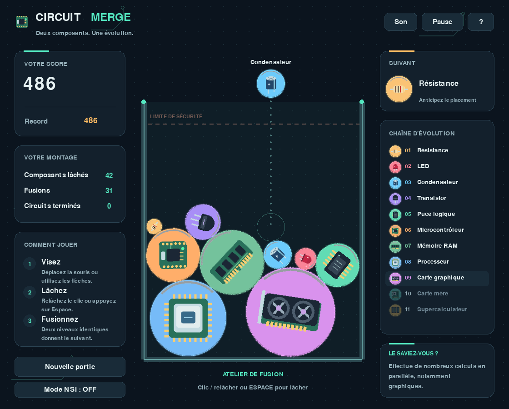

# Circuit Merge

Un jeu Python de chute et de fusion inspiré de la mécanique classique de
Fruit Merge / Suika, dans un univers informatique et électronique.

**Visez, lâchez, fusionnez : de la résistance au supercalculateur.**



## Démarrer sous Windows

1. **Extraire entièrement l'archive ZIP** dans un dossier accessible en écriture.
2. Disposer de **Python 3.12**, conseillé pour cette version. Python 3.10 à 3.13
   sont les versions visées ; les tests fournis ont été exécutés avec Python 3.12
   sous Linux. Le programme reste une application Python, pas un APK Android.
3. Double-cliquer sur **Installer_Windows.bat**. Il crée un environnement `.venv`
   et installe les deux dépendances. Une connexion est nécessaire à cette étape.
4. Double-cliquer sur **Lancer_Windows.bat**. Les lancements suivants fonctionnent
   hors ligne. La console affiche un message si Python ou une dépendance manque.

Installation manuelle depuis PowerShell, ouvert dans le dossier extrait :

```powershell
py -3 -m venv .venv
.\.venv\Scripts\python.exe -m pip install -r requirements.txt
.\.venv\Scripts\python.exe main.py
```

La commande `py` nécessite le lanceur Python de Windows. S'il n'est pas
disponible, remplacer `py -3` par le chemin de l'interpréteur ou par `python`.
Le script de lancement utilise `.venv` lorsqu'il existe. Pour un IDE tel que
Thonny ou PyCharm, sélectionner cet interpréteur et ouvrir `main.py`.

## Démarrer sous Linux / macOS

```bash
python3 -m venv .venv
.venv/bin/python -m pip install -r requirements.txt
.venv/bin/python main.py
```

On peut ensuite utiliser `sh lancer.sh`. Si la création d'un environnement est
indisponible sur Linux, installer le paquet `python3-venv` adapté au système.

Pour une installation dans un interpréteur déjà configuré :

```bash
python -m pip install -r requirements.txt
python main.py
```

## Contrôles

| Action | Commande |
| --- | --- |
| Viser | Souris, flèches gauche/droite, Q/D ou A/D |
| Lâcher | Clic puis relâcher dans le bac, ou Espace |
| Pause / reprise | P ou Échap |
| Recommencer | R ou bouton « Nouvelle partie » |
| Son | M |
| Aide | ? dans l'interface, H ou F3 |
| Mode pédagogique NSI | F1 ou bouton « Mode NSI » |
| Ralenti ×0,25 | F2 |
| Figer l'inspecteur d'une pièce | Clic droit en mode NSI |
| Plein écran | F11 |

En mode NSI, survoler un composant affiche son rayon, sa masse et sa vitesse.
Le clic droit fixe cet inspecteur jusqu'à un clic droit dans le vide ou à la
disparition de la pièce. Les cercles montrent les formes physiques ; les traits
rouges montrent les vitesses avec un facteur d'échelle de 0,12 seconde.
Le toucher SDL est aussi géré sur un écran tactile **d'ordinateur**.

## Règles

- Deux composants du même niveau qui se touchent deviennent un seul composant
  du niveau suivant, plus grand. Les autres contacts produisent des rebonds et
  du roulement. Les sprites tournent avec les corps physiques.
- Seuls les cinq premiers niveaux peuvent apparaître dans la file de lâcher.
  Leur tirage est pondéré, pour favoriser les petits objets. Le prochain objet
  est toujours annoncé à droite ; les objets supérieurs se créent par fusion.
- Le score vient des fusions : la création d'une LED rapporte 3 points, celle
  d'un condensateur 6, etc. Les fusions rapprochées affichent un indicateur de
  chaîne, **sans multiplicateur de score**.
- Le délai entre deux lâchers est de 0,38 seconde. La visée est bornée pour
  tenir compte du rayon et de l'épaisseur des parois.
- La partie se termine lorsqu'une même pièce dépasse la ligne de sécurité
  pendant **2 secondes continues**, après **1,15 seconde de tolérance** suivant
  sa création. Un retour sous la ligne remet son compteur à zéro.
- Créer un supercalculateur est l'objectif. La partie continue pour améliorer
  le score. Deux supercalculateurs qui se touchent disparaissent, rapportent
  132 points et libèrent le bac ; un « circuit terminé » est comptabilisé.
- La ligne pointillée de visée est une projection verticale simplifiée : elle
  ne prédit ni le rebond, ni le roulement, ni les fusions futures.

La progression électronique est une convention de jeu : deux résistances ne
fabriquent pas réellement une LED. Les encarts expliquent le rôle des composants.

## Ce qui est reproduit et ce qui est adapté

Les éléments centraux reproduits sont le bac ouvert, la chute d'un objet à la
fois, les collisions circulaires, les rotations, l'empilement, la fusion au
contact, les tailles croissantes, le prochain objet, le score et le débordement.
Le thème, les illustrations et les sons sont propres à Circuit Merge.

Plusieurs jeux Android portent le nom « Fruit Merge ». Cette version se base
sur la mécanique classique, notamment décrite dans la fiche de **Fruit Merge:
Match Game** ; elle ne prétend pas retrouver les paramètres internes de cette
application. Gravité, tailles, délais et restitution ont été réglés pour ce
projet et sont facilement modifiables dans `circuit_merge/config.py`.

## Sauvegarde

Le record, le son et la partie sont enregistrés automatiquement toutes les
10 secondes, à la fermeture, à la pause et en fin de partie.

- Windows : `%LOCALAPPDATA%\CircuitMerge\save.json`.
- Linux / macOS : `~/CircuitMerge/save.json`.
- Choisir un autre fichier : `python main.py --save-file sauvegardes/alexis.json`.
- Ignorer la partie interrompue : `python main.py --fresh` (le record est gardé).

Une partie restaurée démarre en pause. Les tirages aléatoires futurs sont
conservés. Les contacts physiques sont recalculés : la reprise n'est pas une
répétition exacte, image par image. Une sauvegarde JSON illisible est conservée
sous un nom `save_corrompue_…json` lorsque le disque le permet.

## Pour le cours de NSI

- **`docs/GUIDE_NSI.md`** : architecture, lectures guidées, physique, algorithmes,
  invariants, pièges et expériences.
- **`docs/SUJET_PROJET_NSI.md`** : sujet distribuable, étapes, rôles, livrables
  et proposition de barème sur 20.
- **`docs/NOTES_ENSEIGNANT.md`** : pistes de correction des fonctions élèves,
  différenciation et idées de prolongements.
- **`atelier_nsi/regles_a_completer.py`** : cinq fonctions élèves, sans dépendance.
- **`experiences/chute_libre.py`** : comparaison simulation / modèle mathématique.
- **`Circuit_Merge_Guide_NSI.pdf`** : manuel imprimable et sujet de projet réunis.

Le jeu complet sert de référence fonctionnelle. Distribuer seulement le sujet
et le squelette élèves lorsqu'on souhaite les laisser chercher les règles.
Les notes enseignant contiennent des pistes de solution ; elles peuvent être
retirées de la copie distribuée à la classe.

## Expérimenter et vérifier

```bash
# Tirages reproductibles ; la même graine démarre le même nouveau montage.
python main.py --fresh --seed 42

# Montage de démonstration, sans modifier les sauvegardes.
python main.py --demo

# Étudier le pas de temps.
python experiences/chute_libre.py

# Tests automatisés de physique, sauvegarde et interface sans écran.
python -m unittest discover -s tests -v

# Test de lancement pendant 120 images, sans écrire de sauvegarde.
python main.py --smoke-test 120 --mute

# Capturer le montage de démonstration sans ouvrir de fenêtre.
python main.py --demo --screenshot capture.png
```

Les dépendances testées sont **Pygame 2.6.1** et **Pymunk 7.3.0**. Les tests
utilisent `unittest`, inclus dans Python. Aucun téléchargement d'image, de son
ou de police n'est nécessaire au lancement ; aucun serveur n'est utilisé.

## Organisation

```text
circuit_merge/
    main.py                         Lancement et options
    circuit_merge/
        config.py                   Réglages et catalogue
        model.py                    Pièces, états et événements
        engine.py                   Physique et règles
        app.py                      Entrées et boucle de jeu
        view.py                     Interface et animations
        art.py                      Illustrations vectorielles
        audio.py                    Sons générés
        storage.py                  JSON et écritures atomiques
    tests/                          Scénarios automatisés
    experiences/                    Expérience de chute libre
    atelier_nsi/                     Squelette élèves
    docs/                           Supports pédagogiques
```

## Sources et licence

- Mécanique de référence : [Fruit Merge: Match Game, Google Play](https://play.google.com/store/apps/details?id=com.melon.drop.fruit.merge.master).
- Physique : [documentation officielle Pymunk](https://www.pymunk.org/en/latest/).
- Affichage : [documentation officielle Pygame](https://www.pygame.org/docs/).
- Versions utilisées : [Pygame sur PyPI](https://pypi.org/project/pygame/2.6.1/) et
  [Pymunk sur PyPI](https://pypi.org/project/pymunk/7.3.0/).

Code, dessins et documentation de ce projet : licence MIT, voir `LICENSE`.
Les bibliothèques externes conservent leurs propres licences.
